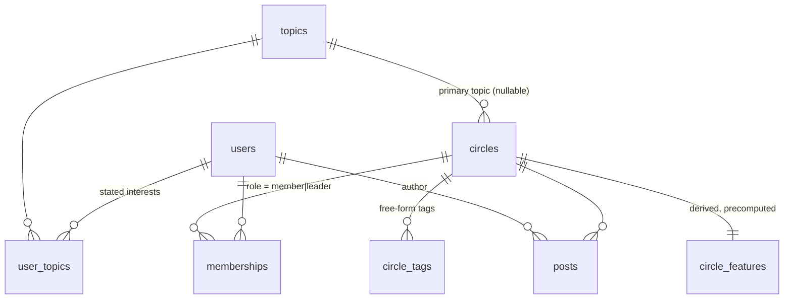

# Database schema

SQLite for local runnability (`src/schema.sql`); every choice below maps directly to Postgres.

## Tables

| Table | Purpose | Notes |
| --- | --- | --- |
| `topics` | Taxonomy (22 slugs) | `slug` unique; the shared vocabulary between users and Circles. |
| `users` | Profile fields + `profile_completeness` | Only fields we might score on or display. |
| `user_topics` | Stated interests (M:N) | Source data had `string[]`; normalised so "who likes topic X" is an index lookup, and FK-checked against `topics`. |
| `circles` | Circle profile, capacity, activity aggregates | `topic_id` **nullable** (2 Circles are untagged). `max_members NULL` = uncapped. `access`, `format`, `join_policy` are `CHECK`-constrained enums. |
| `circle_tags` | Free-form tags | Separate table, not a JSON column, so tag lookups are indexable. |
| `memberships` | User↔Circle with `role` and `joined_at` | Leaders are just `role='leader'` rows (as in the product), no separate leaders table. |
| `posts` | Feed posts with engagement counts | Raw material for engagement/breadth features. |
| `circle_features` | **Derived** per-Circle signals | Engagement per post, distinct posters, join velocity. See below. |

## Decisions worth calling out

- **Full / active are derived at read time, not stored.** `is_full` = `max_members IS NOT NULL AND member_count >= max_members`; staleness
  depends on "now", so storing it would go stale the moment it is written. Only as-of-independent aggregates are materialised.
- **`member_count` is a denormalised counter**, as in the source data. Seeding verifies it matches `COUNT(memberships)` and warns on drift; in production it is
  maintained transactionally with joins/leaves (or by trigger), because the capacity check must be cheap and race-aware.
- **`circle_features` is a cache table, not a source of truth.** The request path should be indexed reads, not an aggregation
  over `posts` per request. Locally it is built at seed time; in production it is a periodic job (or incremental updates from post events).
- **Privacy:** only aggregate chat counts are stored (no message text). Explanations and `leaders` expose first name + last initial and job title only.

## Indexes

| Index | Serves |
| --- | --- |
| `memberships` PK `(user_id, circle_id)` (WITHOUT ROWID) | "Which Circles is this user in?" (exclude + implicit interests) and uniqueness |
| `idx_memberships_circle (circle_id, role)` | Leaders of a Circle; members of a Circle (peer-overlap join) |
| `idx_memberships_joined (circle_id, joined_at)` | Join velocity (`joins_30d`) |
| `user_topics` PK `(user_id, topic_id)` + `idx_user_topics_topic` | A user's interests; members who share a topic |
| `idx_circles_listable (access, last_activity_at)` | Candidate pre-filter: public and recently active |
| `idx_circles_topic`, `idx_circle_tags_tag` | Topic/tag candidate generation, the first thing to hit at scale |
| `idx_posts_circle_created (circle_id, created_at)` | 30-day windows per Circle for feature computation |

At 40 Circles none of this is load-bearing, and the code scores every eligible Circle. The indexes are what makes the same
queries viable once candidate generation (topic/tag lookup → top N → score) replaces score-everything.
